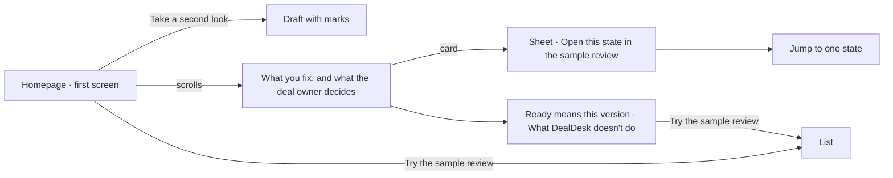

# F1 — From the homepage to the sample review

**Actor** buyer (Chris Okafor) · **Journey** J3 · **Use cases** UC-12, UC-13, UC-14 · **End** the buyer is in the sample with the top bar visible.

| # | Where | What the buyer sees | Action | Response | Branches |
|---|---|---|---|---|---|
| 1 | First screen | "A second look before deal messages leave.", the subtitle, `Try the sample review`, the Harbor draft as written: "This message looks ready. Two issues block it, and one is a warning." | `Take a second look` | Two Blocking and one Warning next to the lines; button "Show it as written" | 1a: call to action at once → step 4 |
| 2 | Roles section | Three cards: "The check finds it", "The coordinator asks", "The deal owner decides" | Opens a card | A sheet: "What it means", "Who acts", "What happens next", `Next step` | 2a: `Open this state in the sample review` → a jump |
| 3 | "Ready means this version", limits | D1 shown in two rows; four limits | Reads | — | 3a: leaves (J3-V2) |
| 4 | "Take the second look yourself" | `Try the sample review` · "No sign-up. Sample data, nothing is sent." | Presses | `app.html#/start` → `RestartSample` → seed | — |
| 5 | Top bar + list | "Sample review · Project Harbor · Simulated: no email is sent"; Harbor "Blocked · 2 blocking issues" | Chooses Harbor | Draft opens (F2 or F3) | 5a: `Back to homepage` |

**Comprehension check (J3-MC1, MC2).** After step 3 the buyer names category and customer, and at least two limits.
