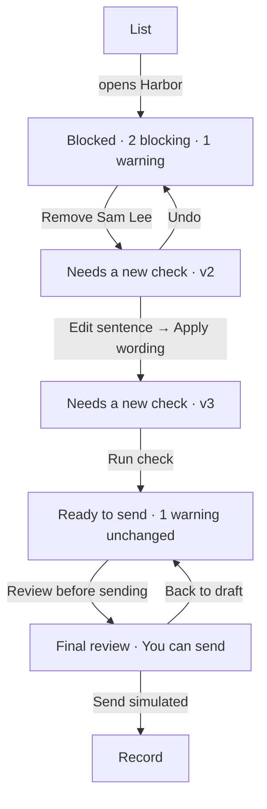

# F2 — Fix and send

**Actor** coordinator (Jordan Blake) · **Journey** J1 main path · **Use cases** UC-01, 02, 03, 05, 09, 10, 11 · **Scenario** SC-1, Undo SC-6 · **End** the record.

| # | Where | What Jordan sees | Action | Command → state | Focus · announcement |
|---|---|---|---|---|---|
| 1 | List | Harbor "Blocked · 2 blocking issues" | Opens it | `OpenDraft` → Blocked | Verdict "Blocked · Check up to date · 2 blocking issues · Can't send yet" |
| 2 | Review notes | Sam's card open, marked "Next": "Blocking · Not on the deal team · …"; Pat and Alex with "On deal team" | `Remove Sam Lee` | `RemoveRecipient` → Needs a new check (v2) | "Sam Lee removed." with `Undo`; "Needs a new check · Recipients changed since the last check (version 1)". **Undo** (SC-6) → Blocked, v1, check up to date |
| 3 | Review notes | The sentence card opens next: "Blocking · Flagged wording · States completion as certain. …" | `Edit sentence` | Editor in the email under the sentence; card "Editing in the message." | Focus on "Suggested wording (you can edit it)" |
| 4 | Draft | "Original" · "We are working towards completion by 30 June." | `Apply wording` | `ApplyWording` → Needs a new check (v3) | "Wording changed. Run the check again."; `Run check` marked "Next". A text that still says "guaranteed" stays Blocked (SC-8) |
| 5 | Verdict | "Needs a new check · Recipients and wording changed since the last check (version 1)" | `Run check` | `RunCheck` → Ready to send | "Checking…", then "Ready to send · Check up to date (version 3) · 1 warning unchanged"; both issues under "Resolved"; Jordan keeps the Warning (J1-3.3) |
| 7 | Final review | "Going to" Pat and Alex; "Removed in version 2"; "Changed", "Warning · unchanged"; "No exceptions used"; "You can send" | `Send (simulated)` | `Send` → Sent | "Sent (simulated)." |
| 8 | Record | "Sent (simulated) to Pat Morgan and Alex Rivera at 11:05 · Version 3 · No real email left the sample." | Reads | — | — |

**Comprehension check (J1-MC3).** At step 7 Jordan answers the three questions from the final review only.
