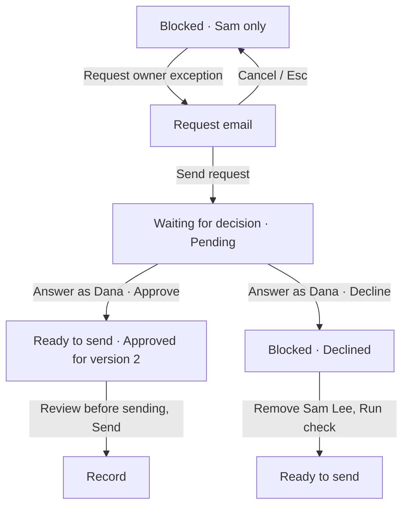

# F3 — Ask for an exception for Sam

**Actor** coordinator; owner simulated · **Journey** J1-V1, V2, J2 · **Use cases** UC-06, 07, 08, 09, 14 · **Scenario** SC-2; branches SC-3 (decline), SC-7 (early request) · **Start** sentence reworded and checked: Blocked only for Sam.

| # | Where | What the user sees | Action | Command → state | Branches |
|---|---|---|---|---|---|
| 1 | Sam's card | "Blocking · Not on the deal team · …" | `Request owner exception` | The request email opens | — |
| 2 | Request | "Project Harbor · Exception request · Sam Lee as recipient", "To: Dana Whitfield (deal owner)", the scope, "Message (version 2)" | Writes "Why does Sam Lee need this message?" | — | **SC-7**: with "guaranteed" still open, "1 blocking issue can still be fixed by editing. Fix it first so Dana approves the final version." |
| 3 | Request | — | `Send request` | `RequestException` → Waiting for decision | Empty reason: "Add a reason so Dana can decide.", focus on the field |
| 4 | Card + verdict | "Pending · Requested from Dana Whitfield at 10:42 · Not approved yet. Sending stays blocked."; "In this sample, answer as Dana from the Simulation panel." | Opens "See why you can't send" | Final review: "Can't send yet: waiting for Dana Whitfield's decision on Sam Lee."; `Send (simulated)` not active | Check J1-MC2 |
| 5 | Simulation → Dana's view | "Waiting for Dana Whitfield since 10:42"; then the request under "Acting as Dana Whitfield (deal owner)" | `Approve exception for Sam Lee` | `Decide(approved)` → Ready to send; card "Approved · by Dana Whitfield · 10:51 · for version 2 · Simulated owner response" | **SC-3**: `Decline` → Blocked, "Dana Whitfield declined an exception"; `Remove Sam Lee` primary → `Run check` → Ready to send. An edit never erases the decline (D1b) |
| 6 | Final review, record | "Exceptions": "Sam Lee by Dana Whitfield, 10:51, for version 2"; the record lists the same decision | `Send (simulated)` | `Send` → Sent | An edit first → F4 |

**Rule visible at every step.** Jordan's view never has an approve control (INV-2). The only place to decide is Dana's view, labelled as simulation.
