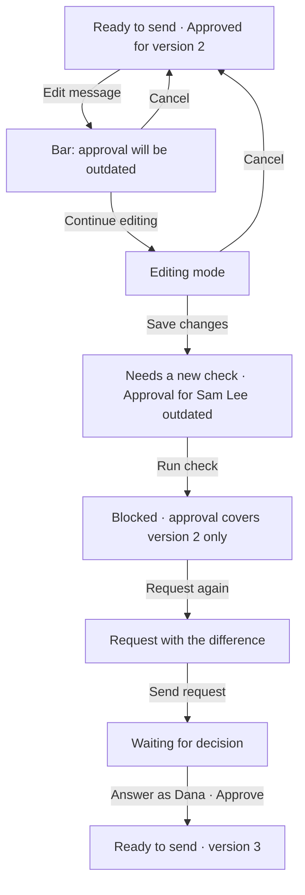

# F4 — Edit a draft that was already checked

**Actor** coordinator; owner simulated · **Journey** J1-V3, J2-V1 · **Use cases** UC-04, 05, 06, 08 · **Scenario** SC-4 · **Start** Ready to send, Sam approved on version 2 (jump "Sam approved by the deal owner") · **End** Ready to send, approved on version 3.

| # | Where | What Jordan sees | Action | Command → state | Focus · announcement |
|---|---|---|---|---|---|
| 1 | Bottom bar | `Edit message` | Presses | The bar shows "Editing will make Dana Whitfield's approval outdated. You'll need to ask again." `Continue editing` · `Cancel` | Focus on the warning |
| 2 | Edit mode | Bar "Editing · Changes aren't saved yet"; verdict "This is the status of the saved version (version 2). Your changes aren't saved or checked yet." | Adds "We'll share the call notes after Friday." | No version while typing | No announcement |
| 3 | Bar | `Save changes` | Presses | `SaveEdit` → Needs a new check (v3); request outdated | "Needs a new check · Wording changed since the last check (version 2)"; "No change made" if nothing changed |
| 4 | Verdict + card | "What changed since the last check": "Added 'We'll share the call notes after Friday.'"; card "Approved on version 2 · doesn't cover version 3" | `Run check` | `RunCheck` → Blocked | "Blocked · Check up to date · Approval for Sam Lee outdated · Can't send yet" |
| 5 | Card, request | `Request again` | Presses, then `Send request` | Request with "Changed since Dana approved version 2" (cannot be removed) → Waiting for decision | — |
| 7 | Dana's view | "Changed since you approved version 2: ‹changes›" | `Approve exception for Sam Lee` | `Decide(approved)` → Ready to send | Card "Approved · … · for version 3" |

**Comprehension check (J1-MC4).** At step 4 Jordan says what changed and what to redo. The first approval stays in the record.
