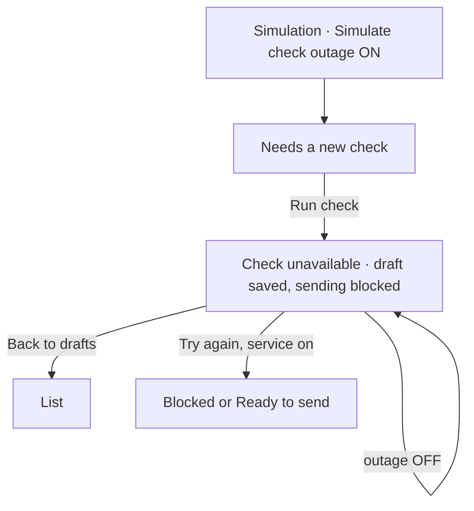

# F5 — Check unavailable

**Actor** coordinator; evaluator for the simulation · **Journey** J1-V4 · **Use cases** UC-05, UC-14 · **Scenario** SC-5 · **End** a status from a new, successful check.

| # | Where | What the user sees | Action | Command → state | Announcement |
|---|---|---|---|---|---|
| 1 | Simulation | "Simulate check outage", "While on, the next check fails as if the service were down. Your draft is kept." | Turns it on | `SetReviewAvailability(unavailable)`; no change in the draft | "Check outage simulated. The next check will fail."; the closed button shows a crossed-out cloud (SM6) |
| 2 | Sam's card | `Remove Sam Lee` | Presses | Needs a new check | — |
| 3 | Verdict | `Run check` | Presses | Failed `RunCheck` → Check unavailable | `role="alert"`: "Check unavailable · Your draft is saved. Sending stays blocked until the check runs." |
| 4 | Verdict + cards | "In this sample, switch off Simulate check outage in the Simulation panel, then try again."; `Try again` · `Keep editing` · `Back to drafts`; old issues "From an earlier check (version 1). May be out of date."; bar "Can't send yet: review is unavailable. Your draft is saved." | `Try again` | Same result, the warning not repeated (R5-F2) | Once. `Back to drafts`: the list shows "Check unavailable" |
| 5 | Simulation | The switch | Turns it off | `SetReviewAvailability(available)`; the draft **stays** Check unavailable | "Check service available. Run the check again." |
| 6 | Verdict | `Try again` | Presses | `RunCheck` → Blocked ("guaranteed" left); Sam under "Resolved" | Status announced |

**Visible rules.** No path sends while the check is unavailable (INV-6); no old result looks current. The unavailable state is drawn in ink and graphite, not red: the message itself does not need to change (CL1).
