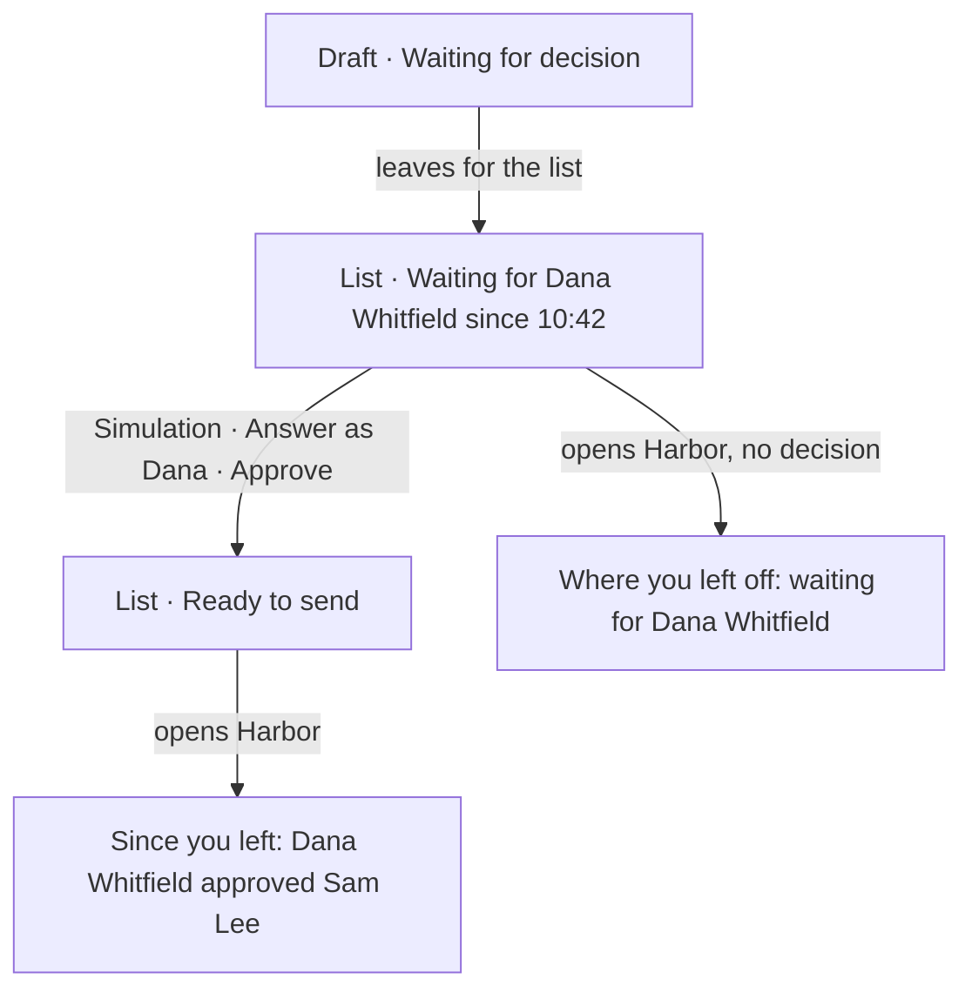

# F6 — Resume after an interruption

**Actor** coordinator; owner simulated · **Journey** J1-V5 · **Use cases** UC-01, UC-07, UC-14 · **Scenario** SC-2 steps 1–3, then leaving and a simulated decision (D8) · **Start** Waiting for decision.

| # | Where | What Jordan sees | Action | Response | Focus |
|---|---|---|---|---|---|
| 1 | Draft | Waiting for decision | Goes to the list, or to another draft | `lastOpenedAt` stays the one of the opening | List |
| 2 | List | Harbor "Waiting for Dana Whitfield since 10:42" | Simulates Dana's answer | `Decide(approved)` → Ready to send; the item updates | — |
| 3 | Draft | "Since you left: Dana Whitfield approved Sam Lee (10:51)." or, with no decision, "Where you left off: waiting for Dana Whitfield since 10:42." | Reads | `OpenDraft` updates `lastOpenedAt` | On the message, before the issues |

Other messages: "Since you left: Dana Whitfield declined Sam Lee (10:55)." and "Where you left off: ready to send." They appear only when the draft is opened from the list: not when coming back from the final review, not on reload, not after a jump (UF20).

**Limit.** "Leaving" means going to the list. A real interruption (other applications, hours later) is not simulated.
