# How I designed the DealDesk homepage and sample review

Design process · DealDesk sample message review

This is a Markdown version of the [design process page](index.html). It has the same eight steps and the same text, without the interactive parts.

Prototype: [homepage](../prototype/index.html) · [sample review](../prototype/app.html#/start)

The brief: help a deal coordinator see if a message is ready to send, and explain the product to the firm that buys it. This page describes the process in eight steps. Each title says what I did.

1. [The problem: wrong messages often look right](#1-the-problem-wrong-messages-often-look-right) · customer, user, problem, outcome
2. [I described the users, their tasks and their mistakes](#2-i-described-the-users-their-tasks-and-their-mistakes) · assumptions and task flow
3. [I defined the review rules before the screens](#3-i-defined-the-review-rules-before-the-screens) · early exploration
4. [I compared options in the working prototype](#4-i-compared-options-in-the-working-prototype) · alternatives and trade-offs
5. [After each test I changed the interface, not the rules](#5-after-each-test-i-changed-the-interface-not-the-rules) · iterations after checking
6. [The app shows first who has to act](#6-the-app-shows-first-who-has-to-act) · final hierarchy, interaction and visual design
7. [The homepage shows the problem first](#7-the-homepage-shows-the-problem-first) · the homepage for the buyer
8. [What I checked, and what still needs real users](#8-what-i-checked-and-what-still-needs-real-users) · checks, limits, next research question

Appendix: [A · Project Harbor, step by step](#a-project-harbor-step-by-step) · [B · The screens at each stage](#b-the-screens-at-each-stage) · [C · How to test it, and how I worked](#c-how-to-test-it-and-how-i-worked)

> Notes like this one mark what is simulated, assumed or not done yet. On the page they are yellow.

## 1. The problem: wrong messages often look right

*Brief: customer, primary user, problem, outcome*

Sam Lee works for the client, so his name looks normal in CC. But he is not on the deal team. A generic warning does not catch this, because it checks the email address, not the deal.

- I identified three roles in the brief: the operations lead who buys the product, the coordinator who sends messages, and the deal owner who approves exceptions.
- I found the same pattern in the three errors: each one looks correct. A known name, a confident sentence, an approval for an older version.
- I defined the goal: the coordinator sees quickly if this version can be sent, and messages without problems are not slowed down.

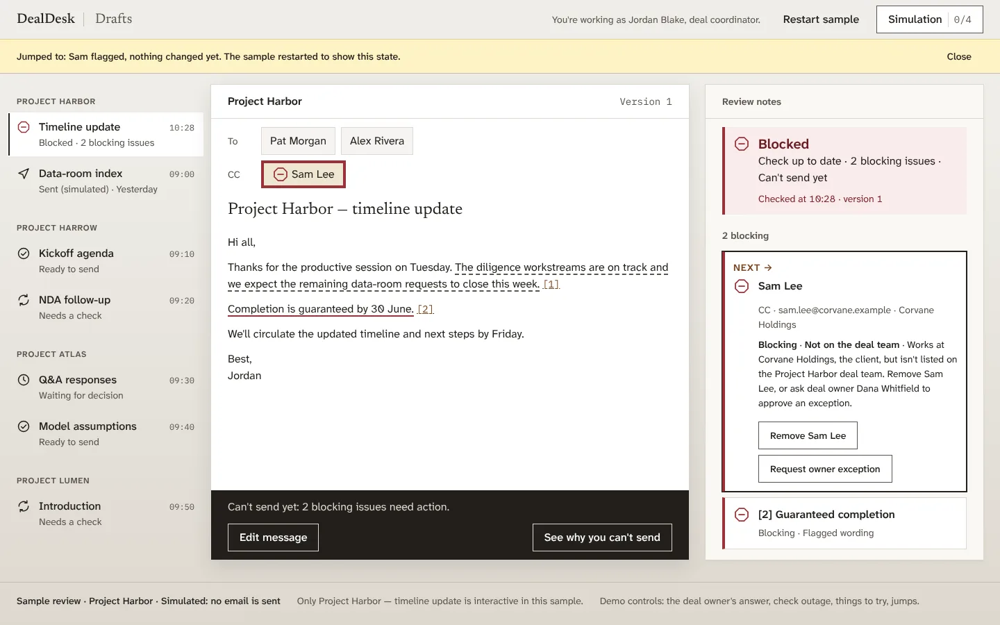

*The sample draft when it opens: two problems that look normal, and both block sending.*

**The three errors, and what each role needs**

| Error | Looks like | Really is | Why it looks correct |
|---|---|---|---|
| Sam Lee in CC | A contact at the client | A person outside the deal team | Known name, the client's email domain |
| "Completion is guaranteed by 30 June." | A positive sentence | A promise the firm cannot make | It sounds sure, not wrong |
| A draft edited after approval | An approved draft | A version nobody approved | The approval is still visible, but it was for the old version |

**Operations lead · buys.** Wants fewer avoidable mistakes and a record of decisions, without slowing every message. The product does not guarantee legal correctness.

**Coordinator · sends.** Works fast on several deals. Recognises names quickly, and can think that a person from the client is on the deal.

**Deal owner · decides.** Approves exceptions. The coordinator can ask, but cannot approve their own request.

## 2. I described the users, their tasks and their mistakes

*Brief: assumptions, task flow*

Before designing screens, I described the work. With a client, this helps to discuss facts instead of personal taste: which task does this screen support, and which mistake does it prevent?

- I split the brief into 91 requirements with an ID each. 59 are in scope, and each one is linked to a screen.
- I wrote three proto-personas and their journeys: each step of the task, and the mistakes possible at each step.
- I turned the journeys into 14 use cases, each with the data it reads and changes. Desk research on seven topics supports the choices.

| | |
|---|---|
| 91 | requirements, each with an ID |
| 3 | journeys with tasks and mistakes |
| 14 | use cases with their data |
| 1 | model of the review rules |
| 1 | page, each requirement linked |

### Task flow (the five steps in the brief)

1. Open the draft: see the deal, the recipients and the status
2. Look at each problem, explained next to the text
3. Fix it, or ask the deal owner for an exception
4. Check the final recipients, text and approvals
5. Send (simulated) and read the record

### Desk research

Approval by a second person, how code-review tools handle approvals after a change, warnings about recipients, reports on emails sent to the wrong person, too many alerts, too much trust in automation, WCAG 2.2. Each later decision refers to a finding.

> **Assumptions, to check with a real client**
>
> - The personas are proto-personas: based on the brief, not on research.
> - The firm has a team list for each deal, and the deal owner keeps it up to date.
> - Text checks are based on patterns: "Flagged wording" asks the user to review, it is not a final judgement.
> - Coordinators write drafts in DealDesk and send them from their normal email.
>
> Not included on purpose: real email, backend, login. Only the Project Harbor draft is interactive. The deal owner's view is simulated.

The detail is in [requirements](../docs/1-requirements/requirements.md), [research](../docs/1-requirements/research.md) and [product](../docs/2-product/README.md).

## 3. I defined the review rules before the screens

*Brief: early exploration*

In the first phase I wrote the rules as a model that a computer can run: what blocks a message, who can approve, what an edit cancels. With fixed rules, I could change the interface many times without the risk of a wrong send.

- I fixed four rules: recipients are checked against the deal team; an approval is valid for one version only; the check runs when the user asks; sending is not possible while something blocks it.
- I tested every possible sequence of actions, also actions that no screen offers, to confirm the rules always hold.
- I created sample data, so the people who collect requirements and the people who build can test ideas on the same structure.

| | |
|---|---|
| 172,919 | states tested: in none of them can a blocked message be sent |
| 0 | cases where the coordinator approves their own exception |
| 0 | cases where an approval stays valid after an edit |

### Why I start from the structure

- **For the client.** Users, tasks and rules help to discuss facts, not preferences: which user task does this choice support?
- **For the developers.** The model and the sample data show what is possible before anything is promised. The prototype uses the same rules, step by step.
- **For the brand.** Colours, type and tone become a reference that grows with the project, useful when the client has no brand guidelines.
- **For the interface.** It can change freely. Each feature has its own documentation, so the project is easy to maintain and extend.

## 4. I compared options in the working prototype

*Brief: alternatives and trade-offs*

For the important choices, I built the options in the working prototype and compared them side by side. Each decision is recorded with the option it replaced and the reason.

| Topic | Chosen | Instead of |
|---|---|---|
| Recipient check | Compare with the deal team | A warning "outside your firm": it appears on every client email and does not separate Sam from Alex |
| Approvals | An approval is valid for one version | Keeping approvals after a change, like code-review tools do |
| Structure | One page: list, draft as an email, notes | Separate screens, where the status was far from the text |
| Brand | "Proofread draft": sepia ink, paper, a serif font | "Paper, not cream" and "Technical memo" |
| Status colour | Red where the message must change, green when it can go | No colour, colour only in the notes, or ochre for warnings |

### Structure

The same step in both versions: asking the deal owner for an exception.

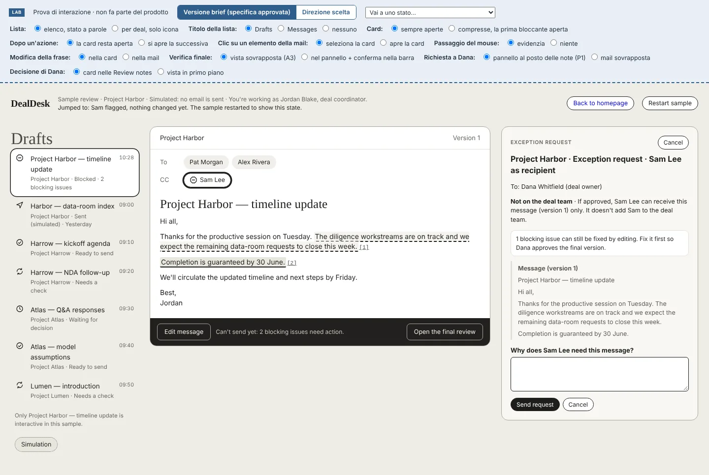

*First version.*

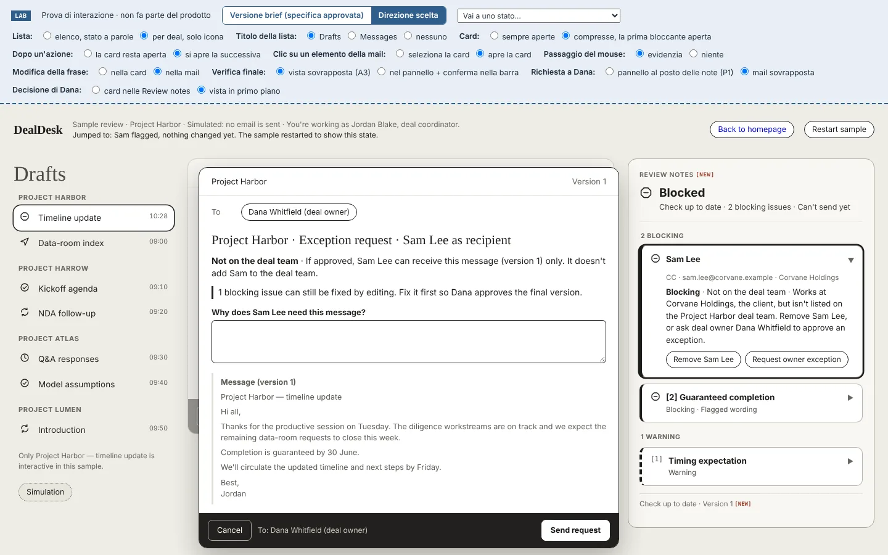

*Chosen.*

### Brand

**1 · Paper, not cream.** Not chosen. Safe, but it did not say much about the product. (Shown with a replacement serif font.)

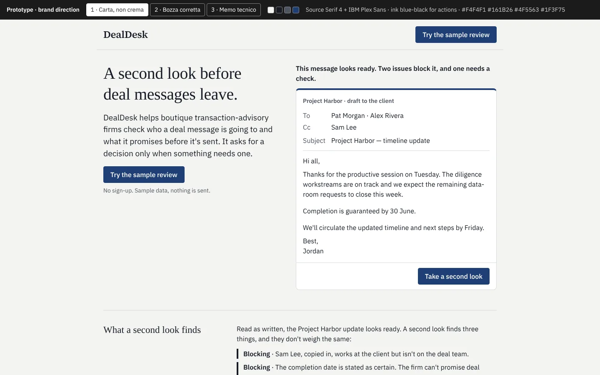

**2 · Proofread draft.** Chosen. Like a second reading by a proofreader: sepia ink, neutral paper, the draft as a sheet. Different from the colours used by similar products.

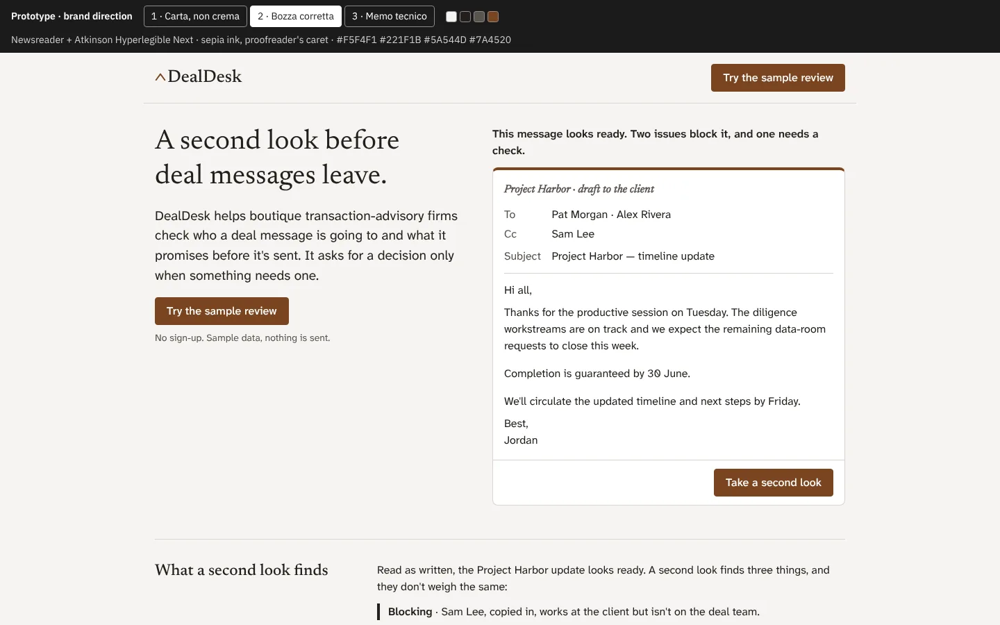

**3 · Technical memo.** Not chosen. Precise but cold for a partner, and the monospaced font everywhere made reading slower.

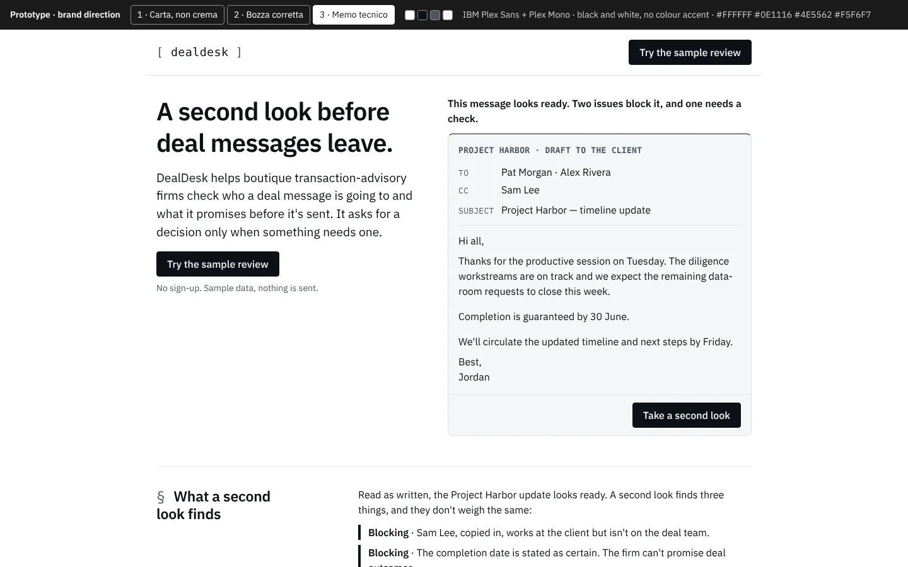

### Status colour

**A · No colour.** Before. Correct and accessible, but nothing guided the eye before reading.

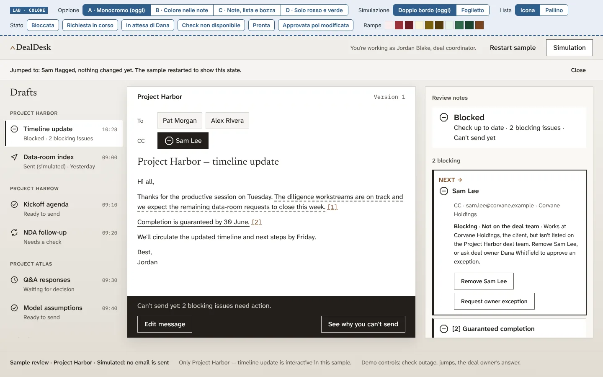

**B · Notes only.** Not chosen. The problem was not visible where the coordinator works: in the draft.

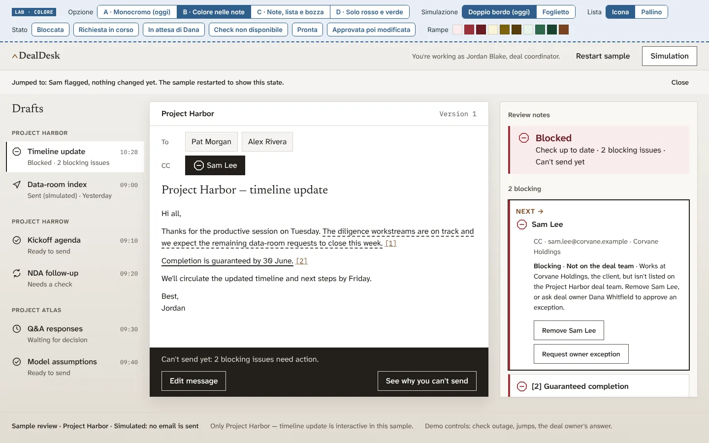

**C · Everywhere.** Not chosen. Ochre warnings looked like the brown action buttons, and green in the list attracted attention to drafts that were already fine.

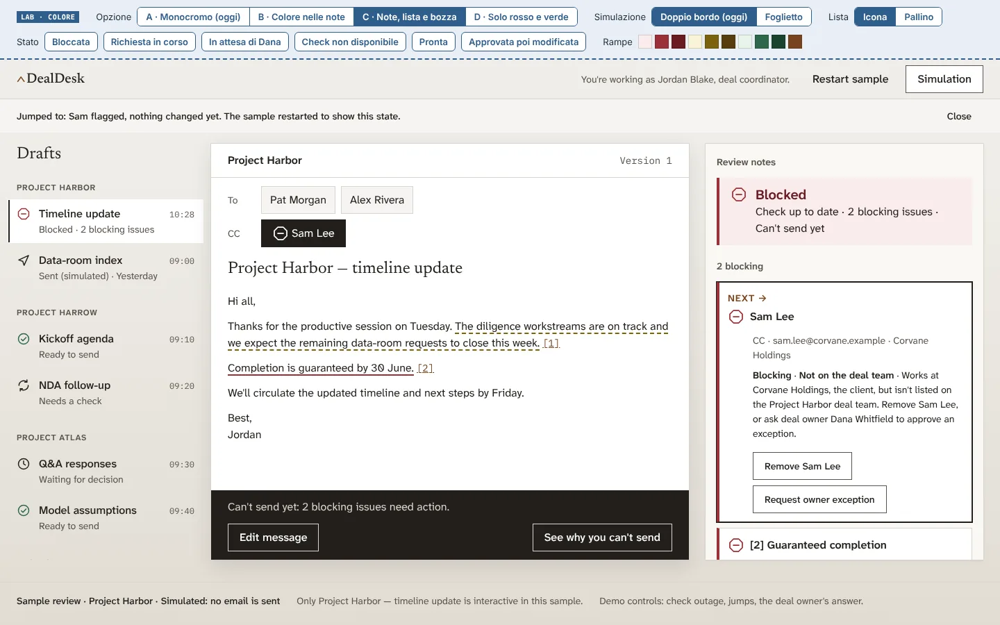

**D · Two colours.** Chosen. One meaning for each colour. Words and icons still show the status without colour.

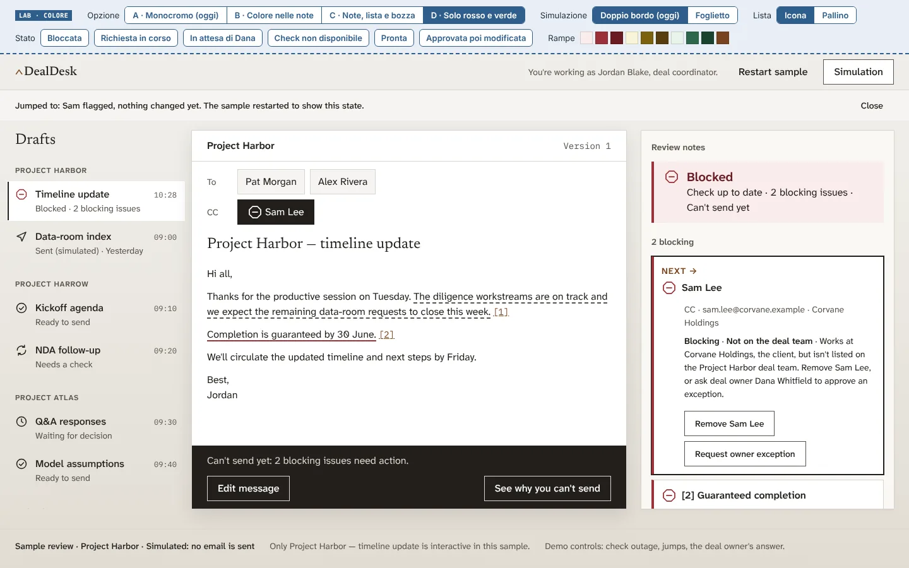

Every decision is in the [decision register](../docs/decisions.md).

## 5. After each test I changed the interface, not the rules

*Brief: a concrete change after checking*

After every test I changed what people see, and kept the rules the same. The first test is the clearest example: the rules were correct, but the screen did not say clearly who receives the message.

- I ran a first comprehension test with new AI readers. "Can it be sent?": correct 21 times out of 21. "Who receives it?": correct only 9 times.
- I added To and CC labels, and the user's name in the top bar. "Who receives it?" went to 20 out of 21.
- I continued in rounds: one page instead of separate screens, a "Next" label, a mobile layout, a UI review, and a final pass on grid, depth and colour.

The same screen in the first build and today:

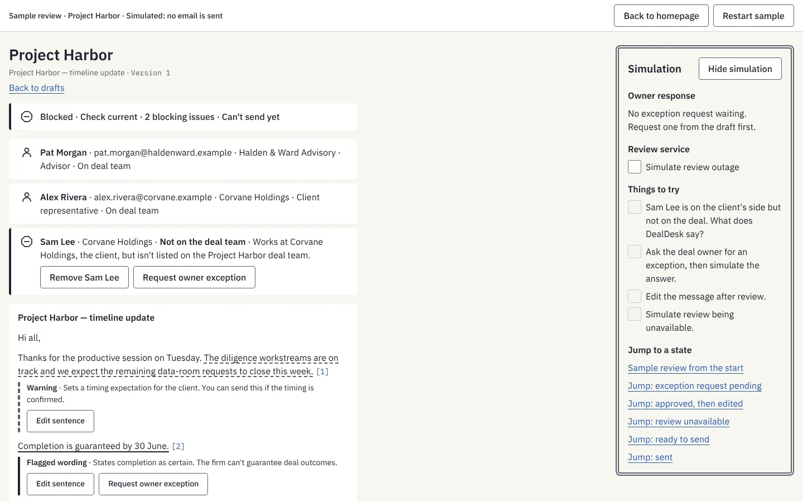

*First build.*

*Final.*

| Question | Before | After |
|---|---|---|
| Can it be sent | 21 | 21 |
| Who receives it | 9 | 20 |
| What is approved | 17 | 21 |

Correct and sure answers out of 21.

> Three AI readers for each round: the result shows a direction, it is not a measurement.

### All the rounds

The review rules were the same in every round. Only the interface changed.

| Date | Interface |
|---|---|
| 9 Nov | First build, separate screens |
| 10 Nov | Usability, brand |
| 11 Nov | Analysis, wireframes |
| 12 Nov | Three columns |
| 13 Nov | Mobile, UI review |
| 14 Nov | Grid, depth, colour |

| Round | Problem found | Change |
|---|---|---|
| Usability | "Who receives it?" was unclear; the user had no name | To and CC labels; "You're working as Jordan Blake" |
| Structure | Six areas with the same weight; the status at the top and at the bottom | One page: list, draft, notes, with the status first |
| Three columns | With two possible actions, readers did not know which came first | "Next" on the action to take; on Run check when a check is needed first |
| Mobile | The top banner filled the first screen; the action was far from the status | Fixed bars at the top and bottom; a shorter status |
| UI review | "Next", selection and focus looked the same | Three different signals; repeated sentences removed |
| Visual pass | Nothing guided the eye to what must change | Sheets on a desk; red and green status colours |

The tests are in [the usability review](../docs/5-evaluation/usability-review.md) and [the comprehension test](../docs/5-evaluation/comprehension-test.md).

## 6. The app shows first who has to act

*Brief: final hierarchy, interactions, visual design*

Each problem starts with one word that says who has to act. The status and the next step are at the top. The draft is in the centre, shown like the email it will be.

- Blocking means the coordinator acts. Pending means the deal owner acts. Ready to send means nobody has to act.
- Each status is different in five ways: word, icon, line style, colour, and if sending is allowed. Colour is never the only signal.
- The next step is always visible: "Next" on the action to take, and "See why you can't send" instead of a hidden button.

| On screen | Who acts | Line | Colour | Sending |
|---|---|---|---|---|
| Blocking · Not on the deal team | The coordinator | Solid | Red | Blocked |
| Warning · Doesn't block | The coordinator, if they want | Dashed | Grey | Allowed |
| Pending · Not approved yet | The deal owner | Solid | Black | Blocked |
| Ready to send | Nobody | Solid | Green | Allowed |

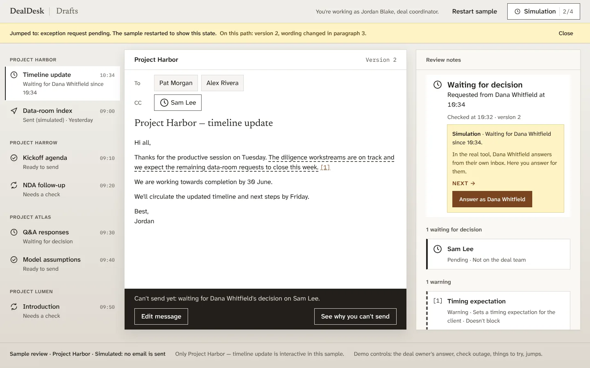

*Desktop: list, draft, notes.*

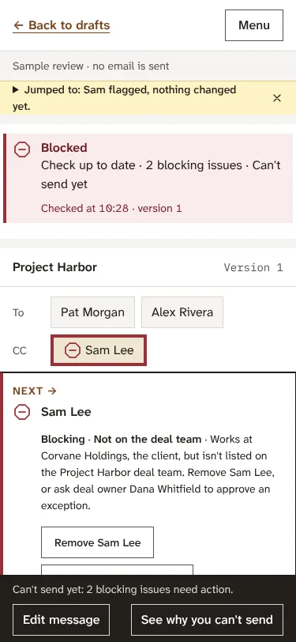

*Phone: each card under its line.*

### Interactions

- Clicking a flagged recipient or sentence opens its card. After an action, the next card opens.
- After an edit, the status says what changed and which approval is no longer valid.
- If the check is not available, the draft is saved, sending stays blocked, and "Try again" is the next step.

### Visual style: sheets on a desk

- The draft is the white sheet in front. A request or the deal owner's view is a sheet on top of it. The final review is the draft lifted up.
- Everything simulated is on a yellow note. This colour is used for nothing else.
- Fonts: Newsreader for titles, Atkinson Hyperlegible Next for text, IBM Plex Mono for versions and times.

### Mobile

- The list is the first screen. A draft opens at full width.
- A bar at the top to go back and open the menu; a bar at the bottom with the reason and the main action.

### Accessibility

- One live region for the status. After each action, focus moves to the next step.
- The send button can still get focus when sending is not possible, and the reason is linked to it. Click targets are at least 24 px.
- In forced-colours mode every sheet keeps a visible border.

The interface is described in [docs/4-design](../docs/4-design/README.md).

## 7. The homepage shows the problem first

*Brief: the homepage for the partner or operations lead*

The buyer must see the problem before the product makes sense. So the page starts with the real Project Harbor draft, which looks ready. One button, "Take a second look", shows what is wrong.

- I wrote it for the buyer: I listed 14 questions an operations lead or partner would ask, for example "Is it for firms like ours?", "Does it slow every message?", "What if the check is wrong?", and I checked the page against each one.
- I made three versions: a page about features, then a page based on the buyer's questions, then a page built on one idea: a message can look ready and not be.
- I built trust without promises: the limits have their own section. No guarantees, numbers, testimonials or logos, and a test fails if one appears. Each example opens the same state in the sample review.

**1 · Features.** First version. Correct, but it listed features. On a phone, the target customer was not visible in the first screen.

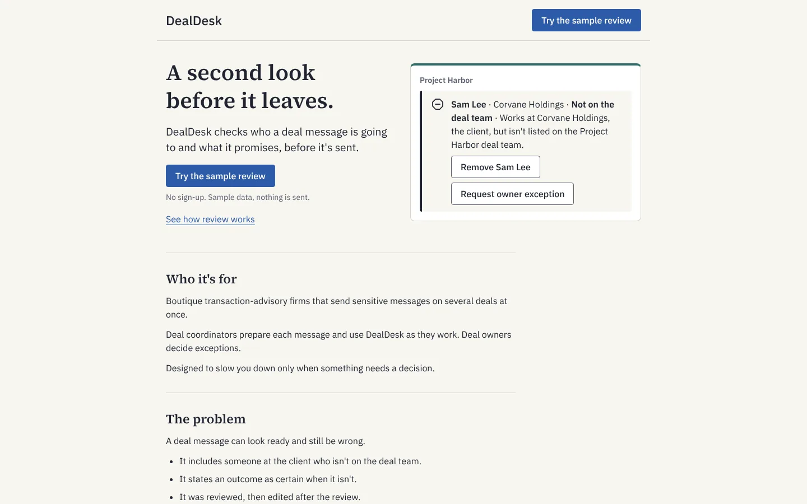

**2 · Buyer's questions.** Second version. Based on the buyer's questions: clearer, but still a list of answers without one main idea.

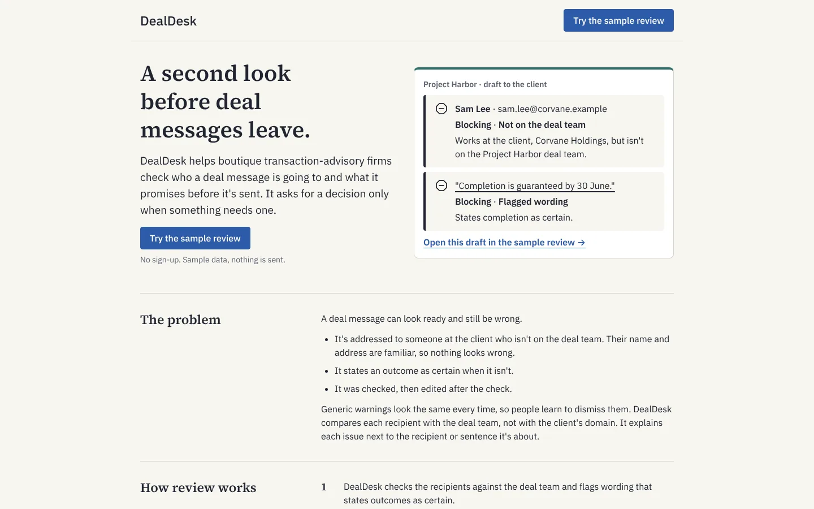

**3 · One idea.** Third version. One idea: the draft as written, then a second look. Each section had to show the difference between looking ready and being ready.

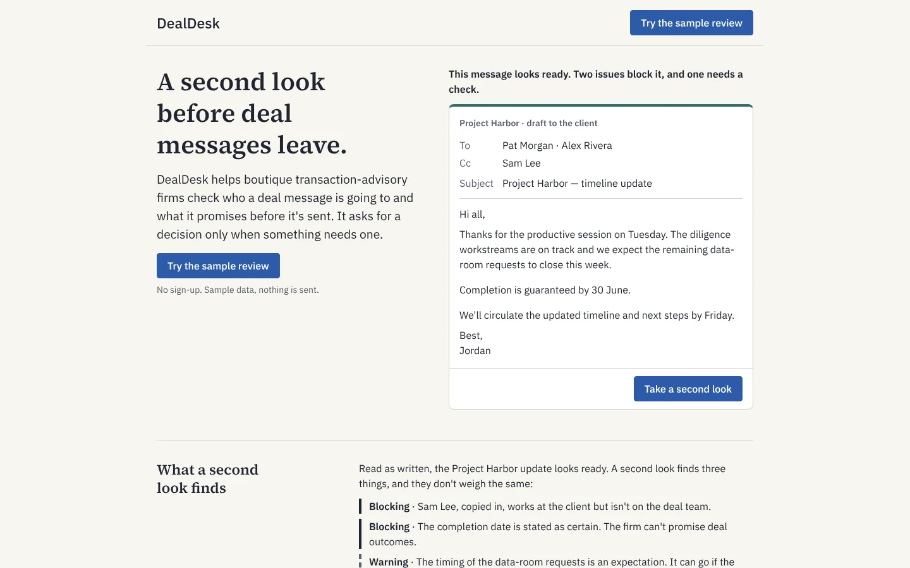

**Today.** The same idea with the product's visual style: the draft is a sheet on the app's desk.

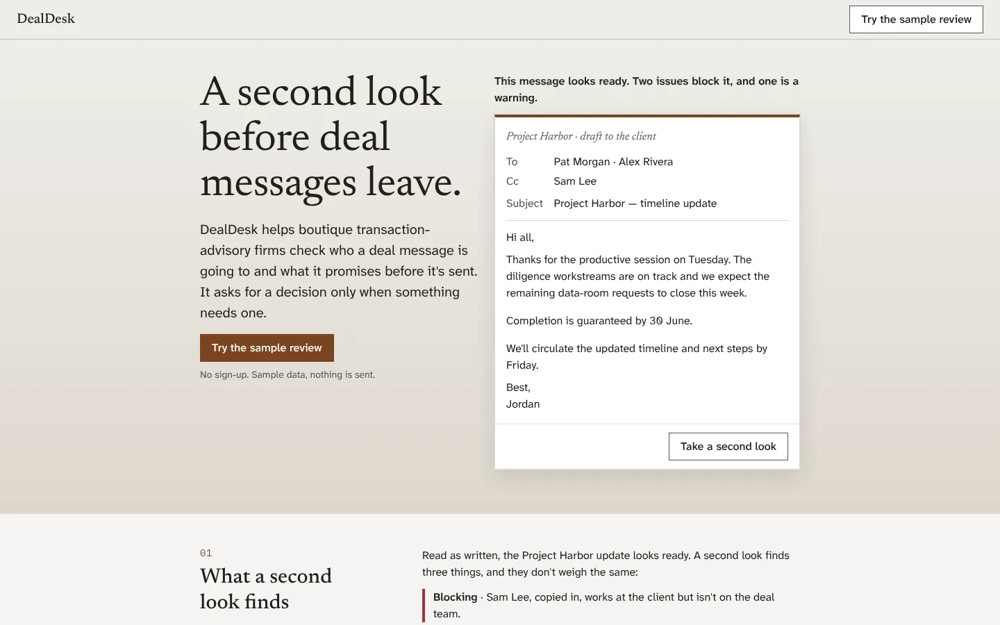

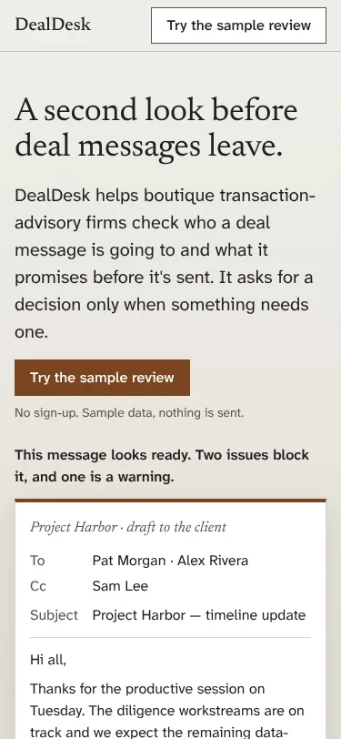

*Phone: what it is, who it is for, and how to try it, in the first screen.*

### What the page covers, and the main idea

| The brief asks | Where the page answers |
|---|---|
| Who uses DealDesk | The first lines say which firms it is for; a later section explains the coordinator who fixes and the deal owner who decides |
| The problem | The Project Harbor draft and its second look; "What a second look finds" |
| How review fits the team | "What you fix, and what the deal owner decides": drafts are written in DealDesk and sent from normal email; deal owners keep the team list and only see what needs them |
| The limits | "What DealDesk doesn't do": it does not send email, it is not a compliance tool, checks can miss things, it cannot see a message after it is sent |
| A way to try the sample | "Try the sample review" in the header, in the first screen and at the end; each example opens its state |
| Trust without false claims | Only real product content. No guarantees, numbers, testimonials, logos or certifications, checked by a test |

**Chosen main idea.** "DealDesk shows the difference between a deal message that looks ready and one that is." It is unexpected, because people think reading again is enough, and Sam Lee makes it concrete.

**Not chosen.** "It checks who a message goes to and what it promises": clear but generic, a competitor could say the same. "Only the deal owner approves an exception": credible, but it starts from the solution.

> Prepared, not done: a five-second test (what is it, who is it for) and a test where people repeat the main idea in their own words. The idea works if at least four people out of five can repeat it.

The brand is in [docs/3-brand](../docs/3-brand/README.md).

## 8. What I checked, and what still needs real users

*Brief: checks, limits, next question, success metric*

Rules, screens and text are checked automatically after every change. Comprehension was checked with AI readers. No other person has used the prototype yet: this is the next step.

| | |
|---|---|
| 305 | browser tests on desktop and phone, including keyboard use |
| 0 | accessibility errors in every state (axe-core) |
| 62 | colour pairs that pass the contrast check |
| 589 | visible texts linked to their specification |

**Next research question · proposal.** When they are in a hurry, do coordinators read "Pending" as "almost approved"? The brief mentions this risk. Only tests with real people can answer it.

**Success metric · proposal.** Share of flagged messages fixed before sending, together with the time it takes to fix them, to make sure that safer does not mean slower.

### What was checked, how, and what was not

| Check | What it shows | Result |
|---|---|---|
| Rules model | Every sequence of actions, up to 10 steps | 172,919 states, all rules hold |
| Same rules in the prototype | The prototype gives the same result as the model | 3,051 of 3,051 steps identical |
| Browser tests | The full scenario, the text of every state, focus, keyboard, grid | 305 pass |
| Accessibility | WCAG 2.2 A and AA in every state at two widths, forced colours, no horizontal scroll at 320 px | 0 errors |
| Text | Every visible text linked to its source; no false claims on the homepage | 589 links pass |

> **Simulated, and not done yet**
>
> - Comprehension tests used new AI readers, and I compared their answers with the model: four questions on eight states.
> - Not done: tests with other people, a real screen reader, browsers other than Chromium. I tested every version myself on desktop and with the keyboard, less on a phone.
> - Based on assumptions: the personas and the brand. Both need real users.

### Limits of the product (also on the homepage)

It does not send email and cannot stop people sending from their own email. It is not a legal or compliance tool. Its checks depend on an up-to-date team list, and flagged text is a reason to review, not a final judgement.

How to run the checks, and the latest results: [VERIFICATION.md](../prototype/VERIFICATION.md).

## Appendix

### A. Project Harbor, step by step

*Brief: walk through the sample scenario*

Each step opens in the prototype at its own address.

1. **The draft opens blocked.** The draft opens blocked: two blocking problems and one warning. Sam Lee's card is open and marked "Next". [Open this state](../prototype/app.html#/jump/flagged)

   

2. **Exception requested for Sam.** Sam is not on the deal team: the coordinator asks Dana Whitfield for an exception. The sentence is the next step. [Open this state](../prototype/app.html#/jump/escalated-first)

   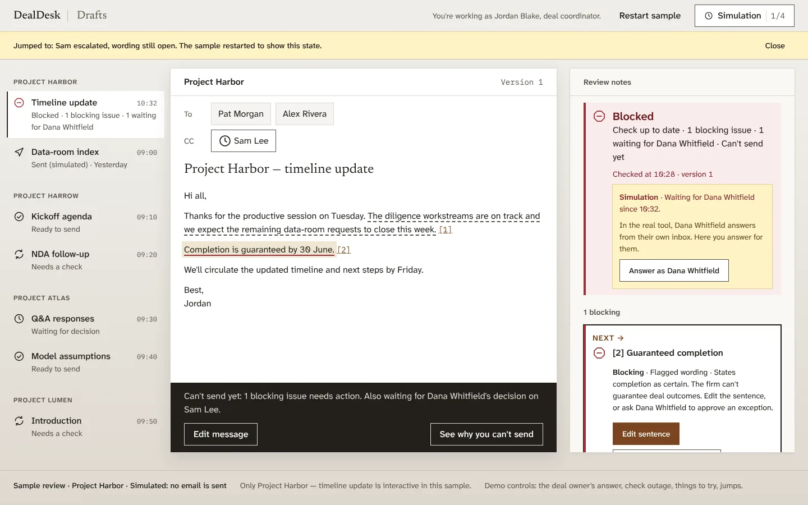

3. **Waiting for the deal owner.** "Not approved yet. Sending stays blocked." The sentence is rewritten. Dana's answer is simulated on the yellow note. [Open this state](../prototype/app.html#/jump/pending)

   

4. **Approved for this version.** Dana approves Sam for version 2. Nothing blocks the message: ready to send, with one warning left. [Open this state](../prototype/app.html#/jump/approved)

   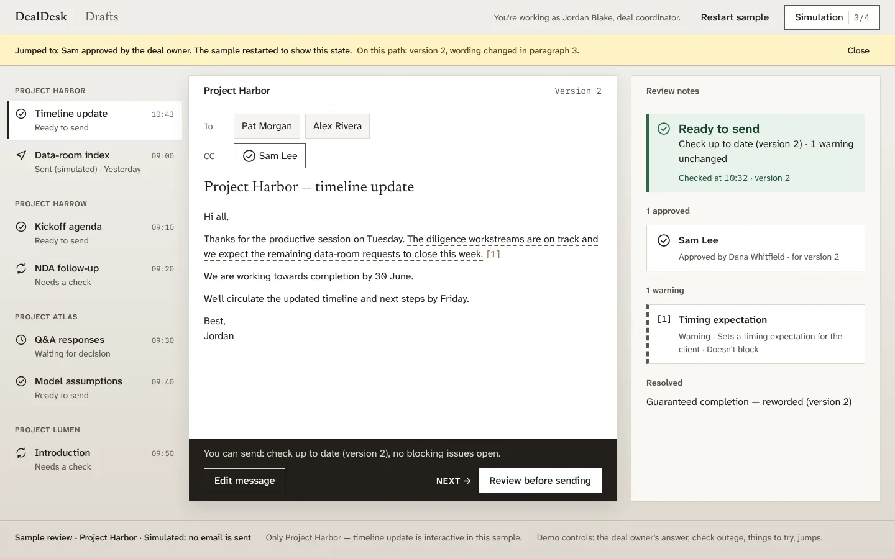

5. **Final review.** The final review: who receives it, what changed, what is approved for this version. [Open this state](../prototype/app.html#/jump/ready)

   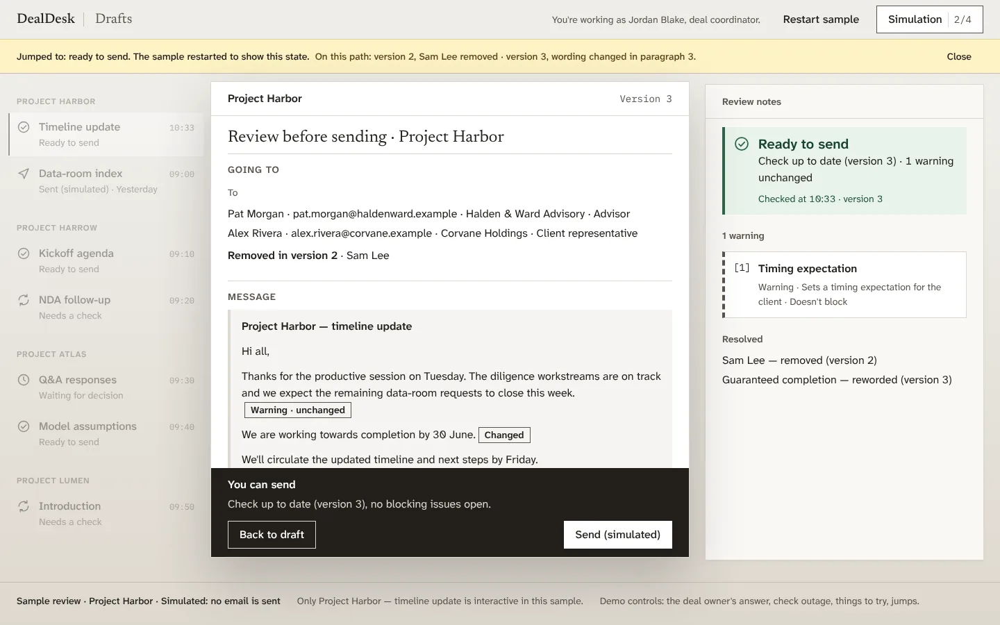

6. **Sent, and the record.** Sent (simulated), with the record: recipients, results, who decided what. [Open this state](../prototype/app.html#/jump/sent)

   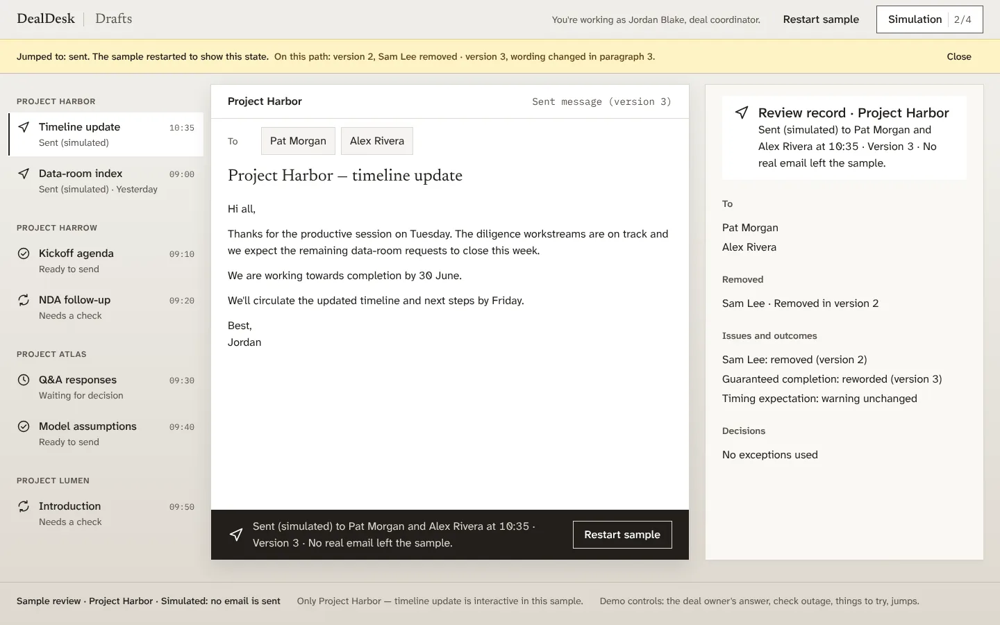

7. **Edited after approval.** An edit after the approval: the check and Dana's approval are no longer valid, and the status lists what changed. [Open this state](../prototype/app.html#/jump/edited-after-approval)

   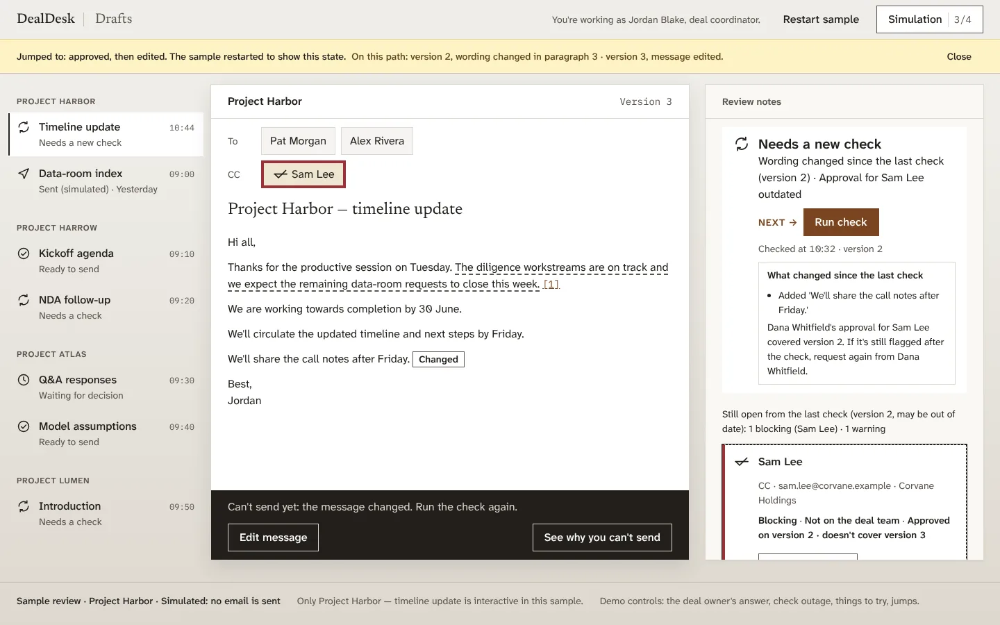

8. **Check not available.** The check is not available: the draft is saved, sending stays blocked, "Try again" is the next step. [Open this state](../prototype/app.html#/jump/review-unavailable)

   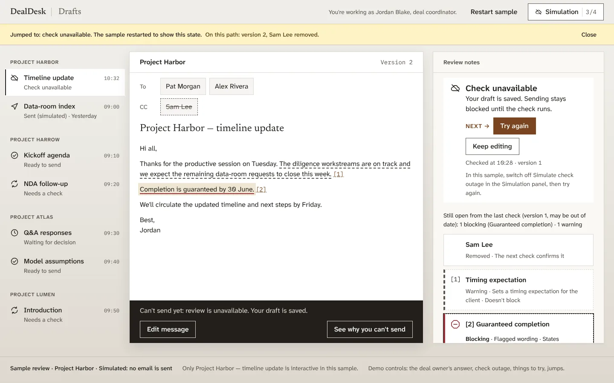

### B. The screens at each stage

*Each stage, opened again from the repository history*

The draft when it opens, at each stage. The other screens of each stage (waiting for decision, edited after approval, final review, record, homepage) are in the folder `img/evolution/`, named by stage and screen, for example [t6-final-2-pending-1440.webp](img/evolution/t6-final-2-pending-1440.webp).

| Stage | Date | Draft opened |
|---|---|---|
| First build | 9 Nov |  |
| Usability, brand | 10 Nov | 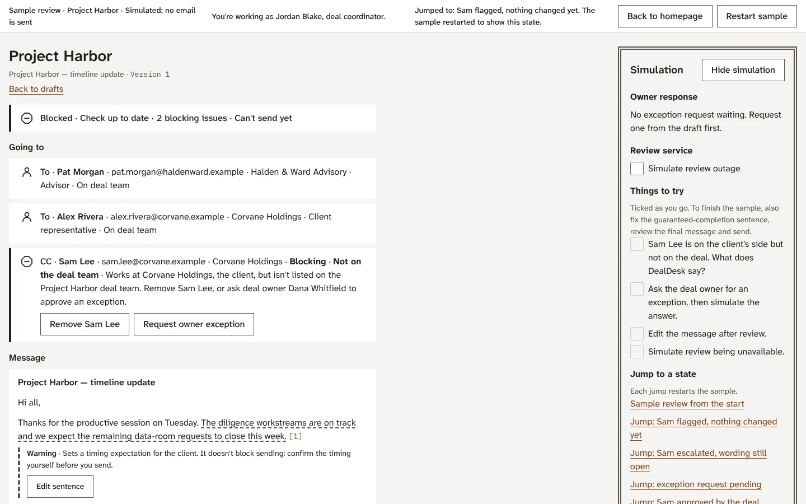 |
| Three columns | 12 Nov | 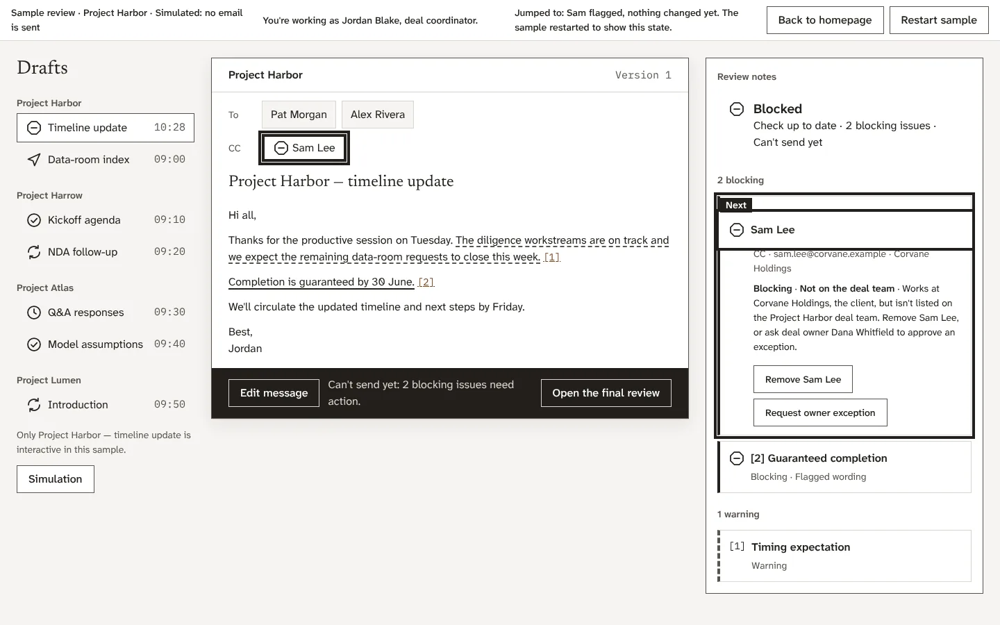 |
| Mobile | 13 Nov | 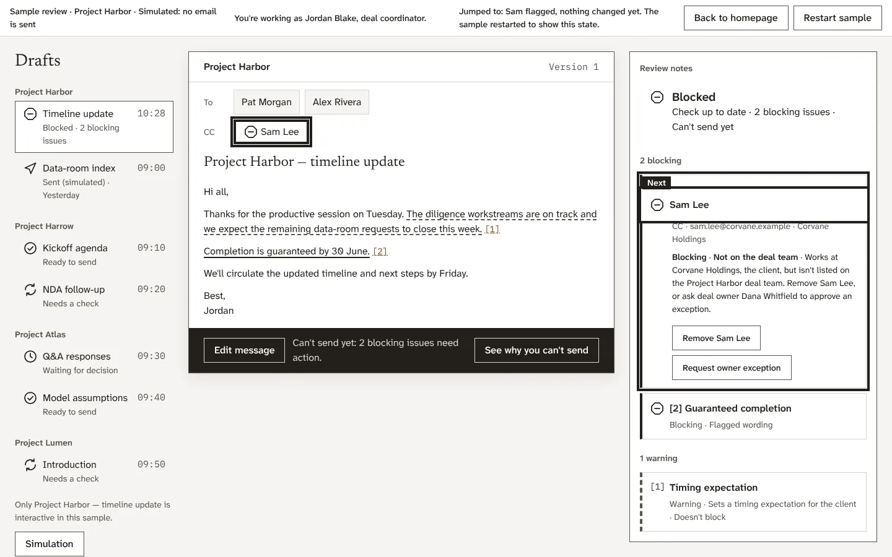 |
| UI review | 13 Nov | 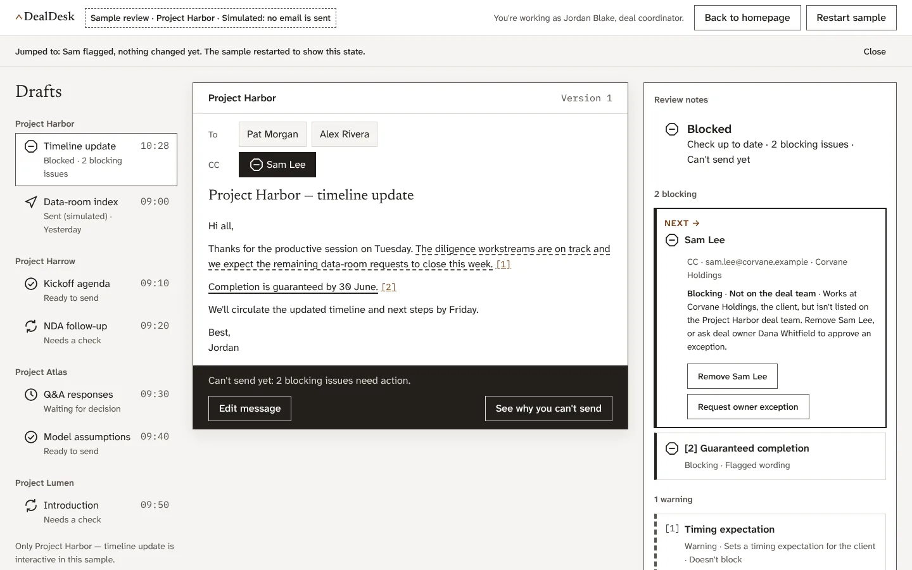 |
| Final | 14 Nov |  |

### C. How to test it, and how I worked

*Method notes requested by the brief*

#### How to test if people understand the message

5 to 8 people who send client emails at work. Eight fixed screens, one at a time. Four questions:

1. Who will receive this message?
2. What has been approved, and by whom?
3. Can it be sent now, and why?
4. What is the next action, and who does it?

Each answer is compared with the model: correct and sure, correct but not sure, partly correct, or wrong. A correct answer given with doubt still counts as a problem.

> **Pass level, proposal:** questions 1 to 3 correct and sure in at least 90% of answers.

The full protocol is in [test-protocol.md](../docs/5-evaluation/test-protocol.md).

#### The questions the screen answers

| Question | Answer on screen |
|---|---|
| Which deal is this? | Deal name above the draft; the list grouped by deal; the version next to the name |
| Why is each problem important? | One line for each problem, next to the text it refers to |
| What can I fix myself? | Blocking problems: remove the recipient, rewrite the sentence, edit the message |
| What needs another person? | An exception, only from the deal owner |
| Can I send? If not, why? | The status at the top and the reason next to the send button, with the same words |

#### How I worked with AI

I used AI agents as a sparring partner and to build. Each step started from a plan that I approved. We exchanged proposals until one worked. Visual and communication choices needed the most rounds: how journeys and states read, and the homepage.

Every decision I accepted is recorded with the option it replaced. I tested every version myself.

**How I checked the AI output**

- A rules model that tests every possible sequence
- The same results in the model and in the prototype, step by step
- Tests that fail on any error in the browser console
- An accessibility check that is tested on a page built to fail
- Every visible text linked to its specification
- Comprehension answers compared with the model, not with an opinion

---

DealDesk is a fictional product made for a design exercise. All companies, people and data are fictional. No real email is sent.

Prototype: [homepage](../prototype/index.html) · [sample review](../prototype/app.html#/start). Repository: [github.com/aitch00/dealdesk-design-exercise](https://github.com/aitch00/dealdesk-design-exercise), with each decision and its alternative, and each check and its limits.
